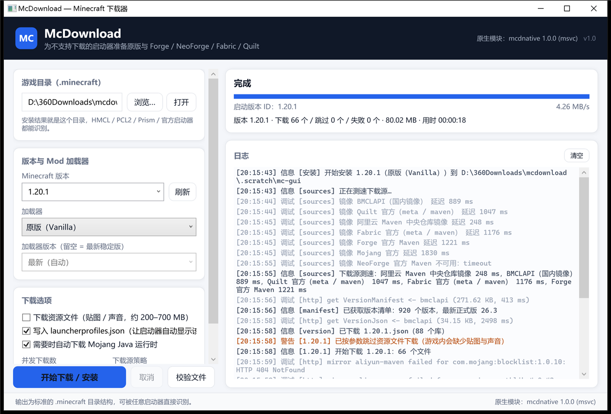

# McDownload

**给「不支持下载游戏本体」的第三方启动器准备的 Minecraft 下载器。**
它把原版（Vanilla）和 **Forge / NeoForge / Fabric / Quilt** 装成一份标准的 `.minecraft` 目录，
装完就能在 HMCL、PCL2、PrismLauncher、官方启动器等任意启动器里直接选版本启动。

- C++ 原生模块（`mcdnative.dll`）+ .NET 10 跨层实现：原生负责 SHA-1 / ZIP 解压等热路径，
  缺失时自动退回纯托管实现，**不会因为没编译 C++ 就跑不起来**。
- 命令行 `mcdl` 与 WPF 图形界面 `McDownload.Gui` 共用同一套核心库（`McDownload.Core`）。
- 多下载站、按实测延迟自动排序、单文件失败自动换源、断点续传、SHA-1 全量校验。



---

## 为什么需要它

不少启动器（尤其是只做「启动」不做「下载」的第三方启动器、某些整合包外壳、内网/离线环境）
只会读取 `.minecraft` 里现成的版本，遇到「游戏本体或加载器还没下载」就直接报错。
McDownload 补齐这一环：按官方元数据把文件放到正确位置，并写好 `launcher_profiles.json`，
剩下的交给启动器。

## 功能一览

| 能力 | 说明 |
| --- | --- |
| 原版安装 | `client.jar`、`libraries`（含 Mojang `rules` 平台过滤、旧版 natives 解压）、`assets`（索引 + 哈希对象 + 旧版 `virtual`/`map_to_resources`）、日志配置 |
| Mod 加载器 | **Forge**、**NeoForge**（含 1.20.1 的 `net.neoforged:forge` 旧坐标）、**Fabric**、**Quilt** |
| 多下载源 | 7 个内置站点（见下表），支持自定义 `sources.json`；按实测延迟自动排序，失败自动切换 |
| 下载可靠性 | 并发下载、`.part` 断点续传、SHA-1 + 大小校验、坏文件自动重下、单站点熔断降级 |
| Java 运行时 | 本机没 Java 时自动下载 Mojang 官方运行时（`java-runtime-gamma`/`delta` 等），供 Forge/NeoForge 安装器使用 |
| 加载器依赖预置 | 解析安装器内的 `install_profile.json`，**先用镜像把安装器要用的库下好**，绕开被墙的 `maven.neoforged.net` |
| 启动器兼容 | 写入标准 `versions/<id>/<id>.json`（加载器用 `inheritsFrom`）与 `launcher_profiles.json` |
| 完整性校验 | `mcdl verify` 只读校验，报告缺失/损坏文件，便于离线环境自检 |
| 诊断 | `mcdl doctor` 检查网络、各下载源延迟、Java、磁盘空间 |

## 下载源

| ID | 名称 | 区域 | 覆盖 |
| --- | --- | --- | --- |
| `mojang` | Mojang 官方 | global | 版本清单、版本 JSON、client.jar、libraries、assets、Java 运行时 |
| `bmclapi` | [BMCLAPI](https://bmclapi2.bangbang93.com/) 国内镜像 | cn | 版本清单/JSON、client.jar、资源对象、libraries（`/maven/`）、Fabric 元数据、NeoForge Maven、Java 运行时 |
| `fabric` | Fabric 官方 | global | Loader 版本列表、profile JSON |
| `quilt` | Quilt 官方 | global | Loader 版本列表、profile JSON |
| `forge` | Forge 官方 Maven | global | 安装器、版本列表、promotions |
| `neoforge` | NeoForge 官方 Maven | global | 安装器、版本列表（含 1.20.1 旧坐标） |
| `aliyun-maven` | 阿里云 Maven 中央仓库镜像 | cn | 普通库的最后兜底（不含 Forge/Fabric 专有构件） |

细节、实测表现与「自己加一个镜像」的方法见 [docs/SOURCES.md](docs/SOURCES.md)。

## 快速开始

### 图形界面

```powershell
dotnet run --project src/McDownload.Gui        # 或运行构建产物 McDownload.Gui.exe
```

选择目录 → 选版本 → 选加载器（加载器版本留空即最新稳定版）→ 开始下载 / 安装。

### 命令行

```powershell
# 原版（默认装到 %APPDATA%\.minecraft）
mcdl install 1.20.1

# Fabric / Quilt（纯元数据合并，不需要 Java，几秒完成）
mcdl install 1.20.1 --loader fabric
mcdl install 1.20.1 --loader quilt

# Forge / NeoForge（自动下载 Java 运行时并执行官方安装器）
mcdl install 1.20.1 --loader forge
mcdl install 1.21.1 --loader neoforge --loader-version 21.1.265

# 指定目录、指定源顺序、只看结果
mcdl install 1.21.4 -d "D:\Games\.minecraft" --source bmclapi,mojang
mcdl verify 1.20.1 --loader fabric -d "D:\Games\.minecraft"
mcdl doctor
```

完整参数见 [docs/USAGE.md](docs/USAGE.md)。

## 安装出来是什么样

```
<.minecraft>/
├─ versions/
│  ├─ 1.20.1/1.20.1.json              原版启动配置（官方元数据原样保存）
│  ├─ 1.20.1/1.20.1.jar               client.jar
│  ├─ 1.20.1/natives/                 旧版本（≤1.18）的 natives 解压目录
│  └─ fabric-loader-0.20.1-1.20.1/    加载器配置（inheritsFrom: 1.20.1）
├─ libraries/                         全部依赖，按 Maven 路径存放
├─ assets/
│  ├─ indexes/5.json                  资源索引
│  ├─ objects/ab/abcd…                哈希对象（文件名 = SHA-1）
│  └─ log_configs/client-1.12.xml     日志配置
├─ runtime/java-runtime-delta/…       按需下载的 Java 运行时
├─ launcher_profiles.json             启动器可见的版本条目
└─ .mcdl/                             mcdl 自己的缓存/安装器/源健康数据（可删）
```

这就是官方启动器与主流第三方启动器共同认可的目录结构，因此「放置文件夹」即可被识别。
启动器实际启动的版本 ID：原版为 `1.20.1`，Fabric 为 `fabric-loader-0.20.1-1.20.1`，
Forge 为 `1.20.1-forge-47.4.28`，NeoForge 为 `neoforge-21.1.265`。

## 项目结构

```
mcdownload/
├─ src/McDownload.Core/      核心库：下载、元数据、镜像路由、安装计划、加载器、Java
├─ src/McDownload.Cli/       命令行 mcdl
├─ src/McDownload.Gui/       WPF 图形界面
├─ native/                   C++ 原生模块（SHA-1 / CRC32 / ZIP，C ABI）
├─ tests/McDownload.Tests/   xunit.v3 单元测试（148 个）
├─ scripts/                  build-native / build / publish / smoke-test
└─ docs/                     架构、下载源、用法文档
```

模块划分与数据流见 [docs/ARCHITECTURE.md](docs/ARCHITECTURE.md)。

## 从源码构建

需要：Windows 10/11 x64、.NET 10 SDK、Visual Studio 2022/2026 的 MSVC x64 工具集
（只编 C# 可跳过 C++，用 `-SkipNative`）。

```powershell
# 一次性：原生 DLL + 解决方案 + 单元测试
powershell -NoProfile -ExecutionPolicy Bypass -File scripts\build.ps1

# 只编 C#
powershell -NoProfile -ExecutionPolicy Bypass -File scripts\build.ps1 -SkipNative

# 发布（可选自包含 / 单文件）
powershell -NoProfile -ExecutionPolicy Bypass -File scripts\publish.ps1 -SelfContained
```

构建产物：

- `src/McDownload.Cli/bin/Release/net10.0/mcdl.exe`
- `src/McDownload.Gui/bin/Release/net10.0-windows/McDownload.Gui.exe`
- `native/build/out/mcdnative.dll`（构建时自动复制到上面两个目录）

> PowerShell 默认执行策略可能禁止运行本地脚本，用 `powershell -ExecutionPolicy Bypass -File ...`；
> 脚本保存为 UTF-8 **带 BOM**，以保证 Windows PowerShell 5.1 正确显示中文。

### 测试

```powershell
# xunit.v3 运行在 Microsoft.Testing.Platform 上，测试项目本身是可执行程序
dotnet build tests\McDownload.Tests
tests\McDownload.Tests\bin\Debug\net10.0\McDownload.Tests.exe

# 也可以（需要允许命名管道；部分安全软件会拦截）
dotnet test tests\McDownload.Tests
```

真实网络冒烟测试（会下载若干 MB 到 `.scratch/`，不会碰你真实的 `.minecraft`）：

```powershell
powershell -NoProfile -ExecutionPolicy Bypass -File scripts\smoke-test.ps1 -Loader fabric
powershell -NoProfile -ExecutionPolicy Bypass -File scripts\smoke-test.ps1 -Loader forge -Version 1.20.1
```

## 已验证

在本机（Windows 10 21H2 / .NET 10.0.12）实际跑通：

| 场景 | 结果 |
| --- | --- |
| 原版 1.20.1（含 3575 个资源文件，621 MB） | 全部下载并校验通过 |
| 原版 26.3（最新版，新版本号方案） | 76 个文件 / 123 MB，通过 |
| Fabric 1.20.1（0.20.1） | profile 合并 + 8 个库，通过 |
| Quilt 1.20.1（0.20.0-beta.9） | 通过 |
| Forge 1.20.1（47.4.28） | 自动装 Java 17 运行时，官方安装器执行成功 |
| NeoForge 1.21.1（21.1.265） | 自动装 Java 21 运行时；官方 Maven 不可达时经 BMCLAPI 预置依赖后成功 |
| 断点/幂等 | 重复执行时 74 个文件全部跳过 |
| 完整性校验 | `mcdl verify` 74 个文件正常，0 损坏 |
| 单元测试 | 148 个通过 |
| GUI | 通过 UI Automation 真实点「开始下载 / 安装」完成一次安装 |

## 已知限制

- 只负责**下载与放置**，不启动游戏、不管理账号、不装 Mod。
- Forge/NeoForge 必须执行官方安装器（要对 client.jar 做二进制补丁），因此需要 Java；
  无 Java 且禁止自动下载时会退化为「只放置启动配置」并给出提示（游戏可能无法启动）。
- 原生 ZIP 解析不支持 ZIP64 与非常规压缩算法，此时自动回退到 .NET `ZipArchive`。
- 资源文件较大（1.20.1 约 621 MB / 3575 个文件），首次安装耗时取决于带宽；可用 `--no-assets` 跳过。
- 未内置代理设置，遵循系统/环境变量代理（`HTTP_PROXY`/`HTTPS_PROXY`）。

## 声明

- 本项目与 Mojang / Microsoft 无关联；「Minecraft」是 Mojang Synergies AB 的商标。
- 只下载 Minecraft 官方启动器本就会下载的公开文件，以及加载器作者公开发布的安装器。
- Forge 安装器作者在 `install_profile.json` 中提示「请勿自动化下载与安装」。
  本工具出于兼容第三方启动器的目的调用官方安装器，属于社区启动器的通行做法；
  如果你认可 Forge 的工作，请考虑支持他们（<https://www.patreon.com/LexManos/>）。
- 请遵守各下载源的服务条款，勿滥用镜像。

## 许可证

MIT，见 [LICENSE](LICENSE)。
