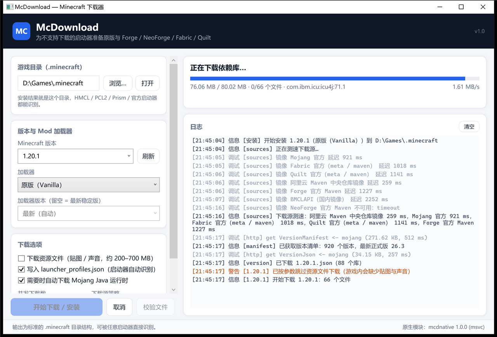

# 使用说明

## 运行前

- 运行环境：Windows 10/11 x64，需要 .NET 10 运行时（自包含发布则不需要）。
- 原生模块 `mcdnative.dll` 与 exe 放在同一目录即可；没有它会自动用托管实现（功能不变，稍慢）。
- 默认目标目录：`%APPDATA%\.minecraft`（官方启动器的标准目录）。建议用 `-d` 显式指定你启动器使用的目录。

```powershell
# 构建后直接运行
src\McDownload.Cli\bin\Release\net10.0\mcdl.exe --help
src\McDownload.Gui\bin\Release\net10.0-windows\McDownload.Gui.exe

# 或从源码运行
dotnet run --project src/McDownload.Cli -- install 1.20.1 --no-assets
```

## 命令行 `mcdl`

### `mcdl install [版本] [选项]`

缺省版本时使用**最新正式版**。

| 选项 | 说明 |
| --- | --- |
| `-d, --dir <目录>` | 目标 `.minecraft` 目录 |
| `-l, --loader <类型>` | `vanilla`（默认）/ `fabric` / `quilt` / `forge` / `neoforge` |
| `--loader-version <v>` | 指定加载器版本；留空取最新稳定/推荐版（如 Forge 用 `47.4.28` 这种不带 MC 前缀的写法也可以） |
| `-j, --parallel <N>` | 并发下载数，默认 16（1–128） |
| `-s, --source <id,id>` | 下载源顺序，如 `bmclapi,mojang` |
| `--sources-file <path>` | 使用自定义 `sources.json` |
| `--priority` | 按配置优先级，而不是实测延迟排序 |
| `--no-probe` | 跳过开头的源测速 |
| `--no-assets` | 不下载资源文件（贴图/声音）。安装更快，但游戏内会缺资源 |
| `--no-profile` | 不写 `launcher_profiles.json` |
| `--no-java` / `--java-path <java.exe>` | 不使用/不使用自动下载的 Java；指定已有 Java |
| `--no-installer` / `--extract-only` | 只放置 Forge/NeoForge 启动配置，不执行安装器 |
| `--profile-name <名称>` | 启动器里显示的条目名 |
| `--refresh` | 忽略本地元数据缓存 |
| `-v, --verbose` | 输出调试日志（含每个文件的源选择） |

示例：

```powershell
mcdl install                                   # 最新正式版，原版
mcdl install 1.20.1 -d "D:\Games\.minecraft"
mcdl install 1.20.1 --loader fabric
mcdl install 1.20.1 --loader forge --loader-version 47.4.28
mcdl install 1.21.1 --loader neoforge
mcdl install 1.20.1 --loader quilt --no-assets
mcdl install 1.21.4 -j 32 --source bmclapi,mojang
```

### `mcdl verify [版本] [选项]`

只读校验：按同样的选项重建文件清单，逐项检查大小与 SHA-1，**不下载**。
适合「文件搬过机器/被清理过」之后自检，或离线环境确认完整性。

```powershell
mcdl verify 1.20.1
mcdl verify 1.20.1 --loader fabric -d "D:\Games\.minecraft"
```

输出 `正常 N 个 / 缺失或损坏 M 个`；有缺失时退出码为 1。

### `mcdl list`

```powershell
mcdl list                 # 远程：默认列 20 个正式版
mcdl list --all -n 50     # 含快照
mcdl list --snapshot      # 只看快照
mcdl list -q 1.20         # 搜索
mcdl list --installed     # 本地：已安装的版本、类型、继承关系、jar 大小
```

### `mcdl loaders [版本] --kind <fabric|forge|neoforge|quilt>`

列出某加载器可用于该游戏版本的所有版本（最新在前），并给出安装示例命令。

```powershell
mcdl loaders 1.20.1 --kind fabric
mcdl loaders 1.21.1 --kind neoforge
```

### `mcdl sources [list|test|enable|disable|export|path]`

```powershell
mcdl sources list           # 表格：ID、名称、区域、优先级、启用状态、最近延迟
mcdl sources test           # 重新测速
mcdl sources disable neoforge
mcdl sources export -o D:\mirror\sources.json
mcdl sources path           # 用户配置路径（不存在则用内置配置）
```

详见 [SOURCES.md](SOURCES.md)。

### `mcdl java`

```powershell
mcdl java                  # 检测本机可用的 Java（>=8）
mcdl java --list           # 列出 Mojang 提供的运行时组件与 Java 版本
mcdl java --install 21     # 下载 Java 21 到 <dir>/runtime（默认 %APPDATA%\.minecraft）
```

### `mcdl doctor`

一次性检查：系统信息、原生模块、目标目录可写性、磁盘空间、各源延迟、已装 Java、缓存位置。

## 图形界面



- **游戏目录**：默认 `%APPDATA%\.minecraft`；如果该位置不可写（受安全策略限制），
  会自动改选一个可写目录并在日志里说明。可随时「浏览…」更换。
- **Minecraft 版本**：下拉列表来自官方清单（正式版），也可以直接输入（快照/旧版）。
- **加载器**：切到 Fabric/Quilt/Forge/NeoForge 时自动查询该游戏版本的可用加载器版本；
  留「最新（自动）」即用最新稳定版（Forge 走 recommended → latest）。
- **下载选项**：资源文件、`launcher_profiles.json`、自动 Java；并发数与下载源策略。
- **开始下载 / 安装**：实时显示阶段、字节进度、速度、当前文件；日志按级别着色。
- **取消**：立即中断；已下载文件保留，下次续传。
- **校验文件**：等价于 `mcdl verify`。

## 与启动器配合

安装完成后，打开你的启动器：

- **HMCL / PCL2**：直接把「游戏目录」指向本工具的目标目录，版本列表里就会出现
  `1.20.1`、`fabric-loader-0.20.1-1.20.1`、`1.20.1-forge-47.4.28` 等条目。
- **PrismLauncher / MultiMC**：把它们实例的 `.minecraft` 指向同一目录（或用「添加实例 → 导入」）。
- **官方启动器**：本工具会写入 `launcher_profiles.json`，重启启动器即可在版本下拉框看到。

> 启动器选择哪个版本取决于它自己的逻辑；加载器版本的 `inheritsFrom` 指向原版，
> 所以原版文件必须一起装（本工具总是先装原版再装加载器）。

## 环境变量

| 变量 | 作用 |
| --- | --- |
| `MCDL_NO_PROGRESS=1` | 命令行不渲染单行进度（适合 CI/日志） |
| `MCDL_GUI_LOG=<path>` | 指定 GUI 崩溃日志路径 |
| `HTTP_PROXY` / `HTTPS_PROXY` | 标准代理变量，`HttpClient` 会自动使用 |

## 退出码

| 码 | 含义 |
| --- | --- |
| 0 | 成功 |
| 1 | 失败（下载/校验/安装错误，细节已打印） |
| 2 | 用法错误（未知命令、参数不对） |
| 130 | 用户中断（Ctrl+C） |

## 常见问题

**「版本清单中没有 “xxx”」**
版本号拼写不对，或该版本已被移除。先 `mcdl list -q <片段>` 确认。

**Forge/NeoForge 安装器失败**
先看日志末尾的安装器输出（本工具会把最后 8–12 行原样贴出来）。常见原因：

- 无法访问 Forge/NeoForge 官方 Maven：已内置「预置依赖 + BMCLAPI」策略，
  若仍失败，检查 `mcdl sources test`，或手动指定 `--java-path` 别的 Java 重试；
- 没有 Java：默认会尝试自动下载 Mojang 运行时；如果之前用 `--no-java` 关掉了，去掉该参数即可，
  也可以先 `mcdl java --install 21` 准备好再装；
- 安全软件拦截写入：换一个可写目录（`-d`），或把工具目录加入白名单。

**「无法在 … 创建目录」**
目标目录只读/无权限/被安全软件拦截。换目录，或给当前用户写权限。

**某些文件一直 403 / 下载很慢**
`mcdl doctor` 看各源延迟；用 `--source` 指定更快的源；或 `mcdl sources disable <慢源>`。
BMCLAPI 偶尔对个别 Maven 路径返回 403（上游镜像拒绝），会自动回退官方源。

**资源文件太大 / 只想先能进游戏**
`--no-assets`。之后想补资源，去掉该参数再跑一次即可（已下载部分会跳过）。

**能装 OptiFine / LiteLoader 吗？**
不自带。OptiFine 需要它自己的安装器；LiteLoader 已过时。可先用本工具装原版，
再用对应安装器补丁。Forge/NeoForge/Fabric/Quilt 四种加载器已内置。

**会封号吗？**
不会。本工具只下载公开的客户端文件，不接触账号、不修改客户端逻辑，也不需要登录。

**能装多个版本到同一目录吗？**
可以，`versions/` 下每个版本独立目录，`libraries`/`assets` 共享去重。
示例：`mcdl install 1.20.1 --loader fabric` 与 `mcdl install 1.20.1 --loader forge`
可以装在同一个 `.minecraft`。
